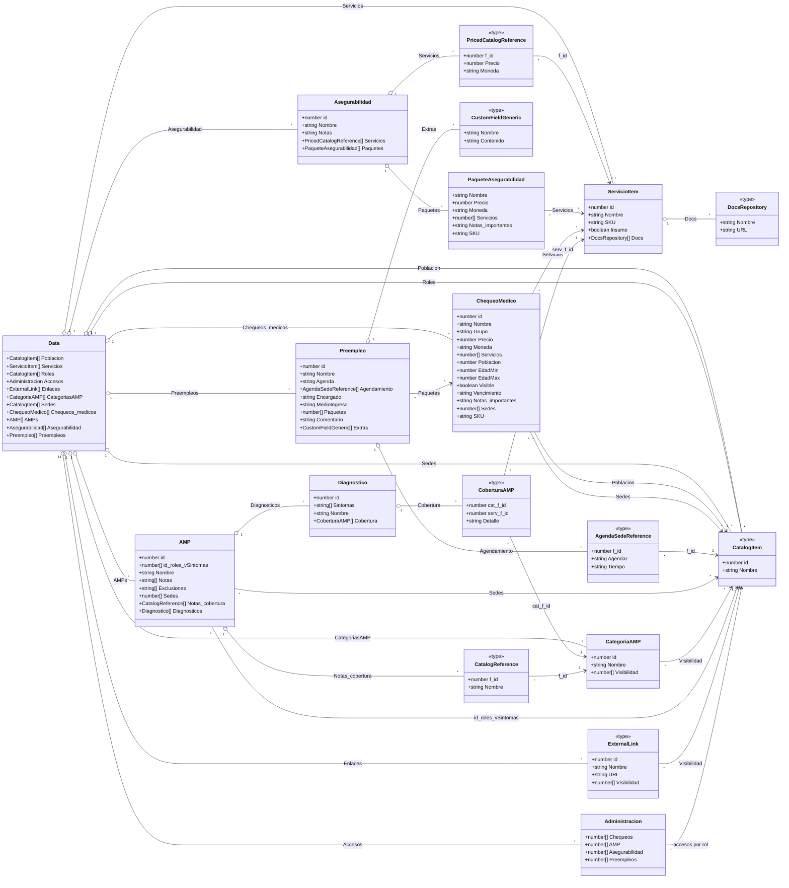

# Esquema de datos

Los campos `f_id`, `Servicios`, `Poblacion`, `Sedes`, `Paquetes`, `Visibilidad`,
`id_roles_vSintomas`, `cat_f_id` y `serv_f_id` contienen identificadores que
referencian otros registros. `Grupo`, `EdadMin`, `EdadMax` y `Detalle` son
opcionales o pueden estar ausentes según el registro. En el diagrama,
`Notas_importantes` representa la propiedad JSON `'Notas importantes'`.
